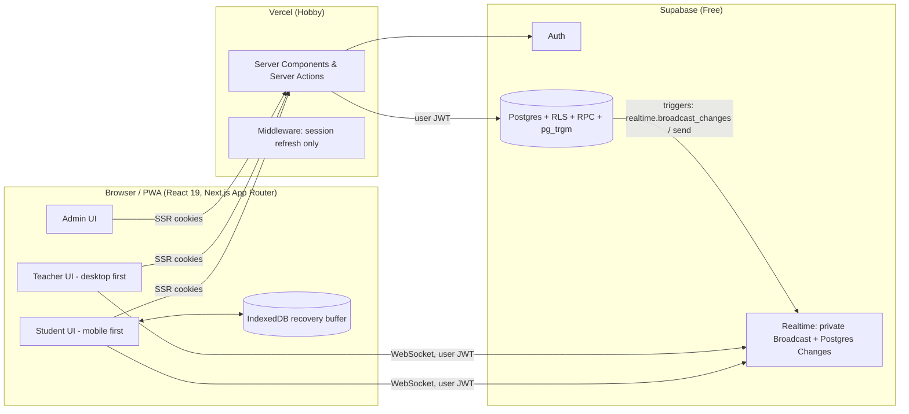
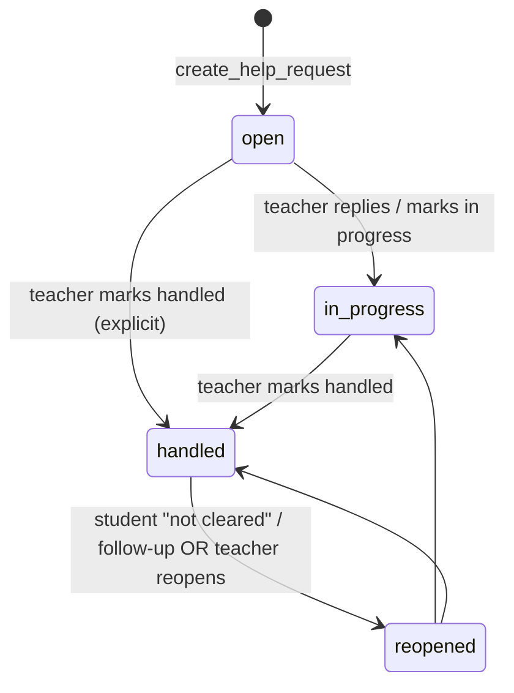

# Classroom Clarity Platform — Product, Behavioural & Engineering Design Document

**Status:** Approved for implementation · **Audience:** Claude Code (primary implementer), human reviewers
**Supersedes:** "Build a production-ready real-time classroom interaction platform" prompt (v1)
**Working name:** *Clarity* (rename freely)

---

## 0. How Claude Code must use this document

1. Read the whole document once before writing code. Then work **one phase at a time** (Section 16). Do not start a phase until the previous phase's exit criteria pass.
2. Create `CLAUDE.md` in the repo root containing: the "Build rules" below, the phase checklist, and the commands to run lint/typecheck/test/build. Update it as you go.
3. After each phase: run `pnpm typecheck && pnpm lint && pnpm test && pnpm build`, apply migrations to a clean local Supabase (`supabase db reset`), run the pgTAP RLS tests, then commit with a message naming the phase.
4. Never claim something works unless you ran it. If something cannot be run in the environment, write "NOT VERIFIED" in `docs/KNOWN_LIMITATIONS.md` with the exact command the human should run.
5. Where this document says **VERIFY**, consult current official docs (Next.js, Supabase, `@supabase/ssr`, Realtime authorization) before coding that part. Package versions: pin the latest mutually compatible stable versions at build time.

### Build rules (non-negotiable)

- TypeScript `strict: true`, `noUncheckedIndexedAccess: true`. No `any` without a comment.
- All authorisation lives in Postgres (RLS + `SECURITY DEFINER` RPCs). The UI and middleware are conveniences only.
- Every write that matters goes through an RPC or a server action that re-derives identity from `auth.uid()`; **never** accept `student_id`, `teacher_id`, `role` or `status` from the client.
- Student text and code are plain text. Render with React text nodes only; never `dangerouslySetInnerHTML`.
- No paid services. No code execution. No AI API. (Similarity/clustering uses Postgres `pg_trgm`, which is free.)
- Success UI is shown only after the server confirms.
- Never log passwords, tokens, code, notes or message bodies.

---

## 1. Review of the original specification

The original spec is strong on scope and security intent. Its weaknesses, and what this document changes:

| # | Gap in v1 | Consequence | Resolution in this doc |
|---|-----------|-------------|------------------------|
| 1 | Treats the problem as *feature delivery*. Nothing addresses **why students stay silent** | Technically correct app that students ignore; adoption is the real risk | Section 2: a behavioural model and 14 concrete mechanisms mapped to features |
| 2 | "Anonymous" questions are anonymous to peers only, but nothing defines what staff can see | Students will not trust a vague promise | Section 6.4: three explicit anonymity modes with an audited reveal, plus honest UI copy |
| 3 | `code_drafts` is both an autosave stream and immutable history | Either write explosion or lost history | Section 8: **one mutable current draft** (compare-and-swap) + **immutable snapshots** + **immutable submissions** |
| 4 | Understanding is "I understand / partly / lost" with no *what* | Teacher knows "30% lost" but not on what | Topic markers: teacher sets the current topic; students tap "lost on *this*"; timeline per topic |
| 5 | No answer to "teacher is lecturing and cannot reply for 10 minutes" | Unanswered requests feel ignored → students stop using it | Auto-acknowledgement, "Q&A window" mode, queue-position and expectation setting |
| 6 | Free-text typing is the only way to ask | Typing a question mid-lecture on a phone is high-friction | One-tap signals, chips, and "ask later" Doubt Bank |
| 7 | Every question is siloed | Teacher answers the same doubt 12 times; students feel alone | Free clustering (`pg_trgm` + topic + activity) and "N others are stuck here" (aggregate only) |
| 8 | No post-lecture loop | Doubts surface at home or before exams, when the app is closed | Doubt Bank + personal "My Clarified Doubts" notebook (the retention hook) |
| 9 | Join code stored as a hash | 6-char codes are trivially brute-forced from a hash; hashing adds nothing | Store code in a teacher-only secrets table, short TTL, rotate, rate-limit, **membership still enforced** |
| 10 | Realtime via table subscriptions implied | Per-row RLS authorisation cost grows with fan-out | Section 9: private Broadcast channels + a single coalesced `session_pulse` row |
| 11 | No teacher-side nudges | Teachers are cognitively overloaded mid-lecture | Pulse-dip alerts, "next best action", reply templates, batch-address a cluster |
| 12 | No success metrics | Cannot tell whether it works | Section 3: north-star + guardrail metrics, privacy-safe instrumentation |
| 13 | "No localStorage as DB" but no offline design | Draft loss on flaky campus Wi-Fi | Section 8.4: IndexedDB recovery buffer, outbox, CAS conflict UI |
| 14 | Role stored "or a secure relationship" | Easy to get wrong via `user_metadata` | Roles in a dedicated table, writable only by `SECURITY DEFINER` admin RPCs |

---

## 2. Product thesis and behavioural design

### 2.1 Why students do not ask (the problem we are really solving)

| Barrier | Research concept | What the student thinks |
|---------|------------------|--------------------------|
| Fear of looking foolish | Social evaluation threat | "Everyone else gets it." |
| Everyone is silent, so everyone concludes they are alone | **Pluralistic ignorance** | "If it were hard, someone would ask." |
| Cost of interrupting | Effort and social cost | "It will derail the class." |
| Not knowing *what* to ask | Metacognitive gap | "I'm lost but can't say where." |
| Previous asks went nowhere | Learned helplessness / no closure | "They never reply anyway." |
| Doubt appears later, alone | Delayed need | "I'll figure it out before the exam." |

**Design thesis:** reduce the *social cost* and *effort cost* of asking to near zero, make the *benefit* immediate and visible, and *close the loop* every time. Anything that does not move one of those three levers is out of scope.

### 2.2 Ethical frame

Engagement mechanics here must serve learning, not time-on-app. Hard rules:

- **No public leaderboards, no public streaks, no "most questions" rankings.** Competition punishes exactly the students we want to help.
- **No variable-reward slot-machine patterns, no guilt notifications, no countdown pressure.**
- **Asking is never graded and never labelled.** No "weak student" tags anywhere in code, copy or reports.
- Every behavioural feature has an off-switch at course level, and any personal-progress feature has an off-switch for the student.
- Copy is honest. Never promise anonymity the system does not provide (Section 6.4).

### 2.3 The mechanisms (feature ↔ psychology ↔ metric)

Each item has an ID used in the backlog (Section 16).

| ID | Feature | Psychological basis | Primary metric |
|----|---------|---------------------|----------------|
| B1 | **One-tap "I'm lost" with zero typing.** Big, thumb-reachable control; optional detail after the tap, never before | Friction removal (Fogg: motivation × ability × prompt) | % of lectures where ≥50% of joined students send ≥1 signal |
| B2 | **Topic markers.** Teacher taps "New topic: Pointers"; student chip "Lost on: Pointers" | Converts vague confusion into specific, actionable data; metacognitive scaffolding | Share of signals attached to a topic |
| B3 | **Reveal-after-commit.** Class pulse is shown to a student only *after* they submit their own signal | Counteracts pluralistic ignorance without conformity bias (no anchoring on others' answers) | Reduction in "partly/lost" under-reporting vs baseline |
| B4 | **"You're not alone" aggregate.** After asking: "11 classmates flagged this topic" (counts ≥ 3 only, to prevent re-identification) | Social proof, normalisation of confusion | Repeat-ask rate of first-time askers |
| B5 | **Instant receipt + expectation setting.** Auto-ack in <1 s: "Received. Position 4 in queue. Your teacher reviews questions at the next pause." | Reduces uncertainty; the biggest driver of abandonment is silence | % requests viewed by student after ack |
| B6 | **Q&A window mode.** Teacher taps "Pause for questions"; students see "Teacher is reading questions now" | Honest expectation management; creates rhythm | Median time-to-first-teacher-response |
| B7 | **Close the loop.** On reply: gentle in-app notice; on handled: "Did this clear it up?" Yes / Partly / No → *No* reopens automatically | Closure (Zeigarnik), efficacy feedback, prevents "handled ≠ understood" | Resolution-confirmation rate; reopen rate |
| B8 | **"Addressed in class" broadcast.** Teacher picks a cluster, writes one anonymised line; every contributing student gets "Your question was addressed" with **no names** | Prosocial reward: "my doubt mattered"; reduces duplicate answers | Cluster-address usage |
| B9 | **Impact message (private).** "Your question helped 6 classmates" after a cluster is addressed | Prosocial motivation, autonomy; replaces points/leaderboards | Repeat asking among recipients |
| B10 | **Doubt Bank (ask later).** Window of N hours (default 48) after a session when students can ask about *that* lecture | Captures delayed doubts; removes in-class pressure entirely | Doubt Bank volume; return visits |
| B11 | **My Clarified Doubts notebook.** One tap saves a teacher reply (and the code snapshot it referred to) into a searchable personal notebook, with an exam-revision view | **Endowment/investment** + genuine utility; the ethical retention hook | Notebook saves per student; revision-mode opens |
| B12 | **Predict-then-reveal polls (confidence-calibrated).** "Predict the output → how sure are you? → reveal." | Retrieval practice, hypercorrection effect, metacognitive calibration | Poll participation; calibration gap trend (private to student) |
| B13 | **Exit ticket / muddiest point.** 60-second optional prompt at session end: "What was the muddiest point?" + 3 tap-confidence | Classic classroom assessment technique; feeds teacher's next-lecture plan | Exit-ticket completion rate |
| B14 | **Personal clarity view (private).** "This week: 5 doubts raised, 4 cleared, 1 open", never compared to anyone | Competence feedback (self-determination theory), no social comparison | Weekly active students |

Teacher-side behavioural support (adoption of the *teacher* is the other half of the problem):

| ID | Feature | Rationale |
|----|---------|-----------|
| T1 | **Thirty-second start.** "Start lecture" from last session template; projector-friendly join view (large code + QR) | Lowest possible activation energy |
| T2 | **Pulse-dip alert.** If lost+partial ≥ threshold for ≥ N minutes, a quiet banner suggests: "Many are lost on *Pointers*. Pause and recap?" | Reduces monitoring burden; suggests the next best action |
| T3 | **Reply templates and guiding-question starters** ("What do you expect line 4 to return?") | Fast, pedagogically sound replies |
| T4 | **Cluster view and batch address** (B8) | Answer once, close many |
| T5 | **Response-time mirror.** Private to teacher: "Median first response this week: 6 min" | Gentle self-awareness, no ranking across teachers |
| T6 | **Post-session digest** with topics ranked by confusion and "start next class with…" suggestions | Immediate payoff for using the tool |

### 2.4 Copy and tone principles

- Normalise: *"Asking is how the class improves. Most lectures have a few people stuck on the same thing."*
- Plain verbs, no jargon: "I'm lost", "Ask privately", "Ask later".
- Never use: "weak", "behind", "failed", "slow", "should have".
- Confirmation copy is specific: not "Success!" but "Sent. Dr. Rao will see this at the next pause."
- A **copy deck** lives in `src/content/copy.ts` so tone is centrally reviewable and testable.

---

## 3. Success metrics and instrumentation

**North star:** *Resolved-doubt rate* = requests confirmed "cleared" by the student ÷ requests raised, per course per week.

**Leading indicators:** signal participation per lecture; ask rate per 10 students; time-to-first-response (median/p90); Doubt Bank volume; notebook saves.

**Guardrails (must not regress):** reopen rate, spam/rate-limit hits, teacher median reply time, p95 draft-save latency, client error rate.

**Instrumentation rules:**
- Aggregate events only, stored in Postgres (`analytics_daily` table fed by a nightly SQL function or trigger-maintained counters). No third-party analytics.
- No per-student behavioural dashboards for teachers beyond what the help-request flow already exposes.
- Document in `docs/PRIVACY.md` exactly what is stored, who sees it, and retention (default: drafts/snapshots 1 academic year, signals 90 days then aggregated).

---

## 4. Personas and primary journeys

**Aarav (student, back row, shy).** Won't raise a hand. Wants to tap "lost" and have someone notice, without anyone knowing it was him.

**Meera (student, diligent, behind on one topic).** Needs to ask a specific question and later find the answer again at exam time.

**Dr. Rao (teacher, 60 students, projector, no TA).** Cannot watch a feed. Needs a glanceable signal and a short "who is genuinely stuck" list she can clear during natural pauses.

**Admin (department office).** Imports roster, assigns teacher roles, disables accounts.

### Journey J1 — Student gets unstuck in class
1. Opens app (PWA) → "Live now: DSA, Lecture 7" → taps **Join** (already enrolled, no code needed if session visible; otherwise code/QR).
2. Teacher moves to topic "Pointers"; chip appears. Aarav taps **I'm lost**. (B1, B2)
3. Instantly sees class pulse (B3) and "Marked. 9 others are also lost on Pointers." (B4)
4. Optional: "Want to say what's confusing?" → category chips + short text; attaches current coding activity automatically.
5. Receipt: "Position 3. Dr. Rao reviews questions at the next pause." (B5)
6. Teacher opens request, sees latest code, sends a guiding question. Aarav sees a banner without losing typing focus. (B7)
7. He replies, then taps **Yes, cleared** → saved offer: "Add to My Clarified Doubts?" (B7, B11)

### Journey J2 — Teacher triages
1. Pulse shows 40% lost on Pointers for 3 min → quiet banner (T2).
2. She taps **Pause for questions** (B6); queue sorted by cluster and wait time.
3. Opens the cluster "Pointers: dereference" (7 requests) → writes one line → **Address in class** → all 7 get B8/B9 notices, queue clears (T4).
4. Opens the one unique coding request: 3-pane view (message | code | reply). Sends hint, marks **In progress**.

### Journey J3 — Doubt Bank at 11 pm
Meera opens last lecture, taps **Ask later**, writes a question with code snapshot attached. Teacher sees it in the next morning's "Doubt Bank" queue, grouped by lecture.

---

## 5. System architecture

### 5.1 Context diagram



### 5.2 Key architecture decisions (ADR summary)

| ADR | Decision | Alternatives rejected | Reason |
|-----|----------|-----------------------|--------|
| 1 | **Postgres is source of truth; Realtime is only a hint.** Clients refetch scoped data on hint | Trusting event payloads as data | Missed events must be recoverable; payloads could be stale/duplicate |
| 2 | **Writes go through `SECURITY DEFINER` RPCs** for anything multi-step or state-machine-bound; plain RLS-checked inserts only for trivial rows | Direct table writes from client | Atomicity, state validation, rate limiting, no client-supplied identity |
| 3 | **Private Broadcast channels per scope** with RLS on `realtime.messages` | One public channel; per-table subscriptions for everything | Prevents leakage; cheaper than per-row authorisation fan-out. VERIFY current Realtime Authorization API |
| 4 | **One coalesced `session_pulse` row per session** | Teacher subscribes to every signal insert | 50 taps become ≤1 update/s to teachers |
| 5 | **Draft = CAS-guarded mutable row + immutable snapshots** | Insert a row per autosave | 10–50× fewer rows, still supports compare and recovery |
| 6 | **Server Components for reads, Server Actions for form mutations, direct RPC from client for high-frequency (signal, draft save)** | All-API-route design | Fewer hops, streaming UI, free-tier friendly |
| 7 | **No service-role key in app runtime** except one isolated server-only admin module used by admin actions and the roster import | Service key in route handlers broadly | Minimises blast radius; admin ops also exposed as RPCs gated by `is_admin()` where possible |
| 8 | **pg_trgm + topic + activity for clustering** | AI embeddings | Free, deterministic, explainable |
| 9 | **PWA (installable, offline shell)**, not native | React Native | One codebase, no store fees |
| 10 | **IndexedDB (via `idb-keyval`) outbox for drafts and pending signals** | localStorage | Larger, transactional, async; permitted strictly as recovery buffer |

### 5.3 Role and permission matrix

`✓` = allowed, `own` = only own rows, `scope` = only within authorised course/session, `—` = denied.

| Resource | Student | Teacher | Admin |
|----------|---------|---------|-------|
| Own profile | own R/W (not role/status/UG after verify) | own | R/W all, role changes via RPC |
| Courses | R if enrolled | R/W if owner/co-teacher | R/W all |
| Course members | own R | scope R/W | R/W |
| Sessions | R if enrolled; join | scope R/W/lifecycle | R |
| Join code | — | scope R | — |
| Signals | own W | scope R **aggregate** (+individual if policy on) | — |
| Help requests | own R/W (create, follow-up, reopen) | scope R, status W | — |
| Request messages | own-request R/W | scope R/W | — |
| Teacher notes | **—** | scope R/W (author-only edit) | — |
| Code draft (current) | own R/W | scope R if student in authorised session/activity | — |
| Snapshots / submissions | own R; submissions create | scope R | — |
| Polls / responses | respond own; own R | scope R aggregate + individual | — |
| Doubt Bank | own | scope | — |
| Identity reveal (anonymous) | — | via audited RPC per mode | break-glass RPC, audited |
| Roster | — | — | R/W |

### 5.4 Route map

Public: `/`, `/login`, `/register`, `/forgot-password`, `/reset-password`, `/auth/callback`, `/auth/confirm`, `/privacy`.

Student: `/student` · `/student/join` · `/student/sessions/[id]` (live) · `/student/sessions/[id]/activity/[aid]` · `/student/help` · `/student/help/[rid]` · `/student/notebook` (B11) · `/student/courses` · `/student/profile`.

Teacher: `/teacher` · `/teacher/courses` · `/teacher/courses/[cid]` · `/teacher/sessions` · `/teacher/sessions/[sid]` (live console) · `/teacher/sessions/[sid]/help/[rid]` · `/teacher/sessions/[sid]/present` (projector view) · `/teacher/sessions/[sid]/summary` · `/teacher/activities` · `/teacher/doubt-bank`.

Admin: `/admin` · `/admin/users` · `/admin/roster` · `/admin/settings`.

Every route must contain real functionality. Authorisation: a server-side `requireRole()` helper in each layout **and** RLS in the database.

---

## 6. Detailed backend design

### 6.1 Auth and identity

- `@supabase/ssr` with cookie-based sessions. In server code use `supabase.auth.getUser()` (or `getClaims()`; VERIFY current guidance). **Never** trust `getSession()` alone on the server.
- Middleware does session refresh only; role checks happen in layouts and DB.
- Signup collects `full_name`, `ug_number` into `raw_user_meta_data` (user-controlled, therefore untrusted). A `AFTER INSERT ON auth.users` trigger (`handle_new_user`) creates `profiles`, normalises/validates the UG number against the configured regex, enforces roster mode, and **always** assigns role `student`.
- Roles live in `user_roles` (not in user metadata), writable only through `admin_set_role()`.
- Roster mode on: profile `verification_status = 'pending'` unless a matching roster row exists; **all course/session access policies require `is_verified()`**. Pending users see a "We're checking your details" screen.
- Anti-enumeration: public auth errors are generic ("Check your details and try again"). Duplicate-email behaviour follows Supabase's non-enumerating flow; duplicate UG returns the same generic message while an admin-only audit row is written.
- UG regex stored in `platform_settings.ug_regex` (default `^UG\/\d{2}\/\d{5}$`); the same pattern is exported to the client from one shared module. Normalisation: `upper(btrim(x))`; display value preserved separately. Do not "fix" malformed input.

### 6.2 Schema (core DDL — implement in numbered migrations)

Migration order: `0001_extensions_settings`, `0002_identity_roles`, `0003_courses_sessions`, `0004_activities_code`, `0005_help_requests`, `0006_polls_signals_pulse`, `0007_doubt_bank_notebook`, `0008_rate_limit_audit`, `0009_rls`, `0010_rpc`, `0011_realtime_authz`, `0012_indexes_views`, `0013_seed_dev_only`.

```sql
-- 0001
create extension if not exists pg_trgm;
create extension if not exists pgcrypto;

create table platform_settings (
  id boolean primary key default true check (id),          -- singleton
  roster_mode boolean not null default false,
  ug_regex text not null default '^UG\/\d{2}\/\d{5}$',
  ug_unique boolean not null default true,
  default_doubt_bank_hours int not null default 48,
  updated_at timestamptz not null default now()
);
insert into platform_settings default values;

-- 0002
create type app_role as enum ('student','teacher','admin');
create type verification_status as enum ('pending','verified','rejected','disabled');

create table profiles (
  id uuid primary key references auth.users(id) on delete cascade,
  full_name text not null check (char_length(full_name) between 2 and 120),
  ug_number text,
  normalised_ug text,
  verification verification_status not null default 'pending',
  created_at timestamptz not null default now(),
  updated_at timestamptz not null default now()
);
create unique index profiles_ug_unique on profiles(normalised_ug) where normalised_ug is not null;

create table user_roles (
  user_id uuid primary key references profiles(id) on delete cascade,
  role app_role not null default 'student',
  granted_by uuid references profiles(id),
  granted_at timestamptz not null default now()
);

create table roster_entries (
  id uuid primary key default gen_random_uuid(),
  normalised_ug text not null unique,
  normalised_name text not null,         -- lower, collapsed whitespace
  claimed_by uuid unique references profiles(id),
  created_at timestamptz not null default now()
);

-- 0003
create table courses (
  id uuid primary key default gen_random_uuid(),
  org_id uuid,                                  -- reserved for multi-institution
  title text not null check (char_length(title) between 2 and 160),
  description text check (char_length(description) <= 2000),
  owner_id uuid not null references profiles(id),
  settings jsonb not null default '{
    "anonymity_mode":"masked",
    "doubt_bank_hours":48,
    "behaviour": {"pulse_reveal_after_commit":true,"impact_messages":true,"exit_ticket":true}
  }',
  created_at timestamptz not null default now()
);
create type member_role as enum ('student','teacher');
create type enrol_status as enum ('active','invited','removed');
create table course_members (
  course_id uuid references courses(id) on delete cascade,
  user_id uuid references profiles(id) on delete cascade,
  member_role member_role not null,
  status enrol_status not null default 'active',
  created_at timestamptz not null default now(),
  primary key (course_id, user_id)
);
create index course_members_user on course_members(user_id, status);

create type session_status as enum ('scheduled','live','ended');
create table sessions (
  id uuid primary key default gen_random_uuid(),
  course_id uuid not null references courses(id) on delete cascade,
  teacher_id uuid not null references profiles(id),
  title text not null check (char_length(title) between 2 and 160),
  scheduled_at timestamptz,
  started_at timestamptz,
  ended_at timestamptz,
  status session_status not null default 'scheduled',
  questions_paused boolean not null default false,
  qa_window_open boolean not null default false,             -- B6
  current_topic_id uuid,                                      -- B2
  settings jsonb not null default '{}',                       -- overrides course settings
  version int not null default 0,                             -- optimistic lifecycle control
  created_at timestamptz not null default now(),
  check ((status='scheduled') or started_at is not null),
  check ((status<>'ended') or ended_at is not null)
);
create index sessions_course_status on sessions(course_id, status, scheduled_at desc);

create table session_secrets (          -- teacher-only; never exposed to students
  session_id uuid primary key references sessions(id) on delete cascade,
  join_code text not null,
  expires_at timestamptz not null
);
create unique index session_join_code_active on session_secrets(join_code);

create table session_members (
  session_id uuid references sessions(id) on delete cascade,
  student_id uuid references profiles(id) on delete cascade,
  joined_at timestamptz not null default now(),
  last_seen_at timestamptz,
  primary key (session_id, student_id)
);

create table topics (                    -- B2 teacher-set topic markers
  id uuid primary key default gen_random_uuid(),
  session_id uuid not null references sessions(id) on delete cascade,
  label text not null check (char_length(label) between 1 and 80),
  started_at timestamptz not null default now(),
  ended_at timestamptz
);
create index topics_session on topics(session_id, started_at);

-- 0004
create table activities (
  id uuid primary key default gen_random_uuid(),
  session_id uuid not null references sessions(id) on delete cascade,
  title text not null, statement text not null check (char_length(statement) <= 20000),
  language text not null default 'plaintext',
  starter_code text not null default '' check (char_length(starter_code) <= 100000),
  config jsonb not null default '{}',
  due_at timestamptz,
  created_by uuid not null references profiles(id),
  created_at timestamptz not null default now()
);

create table code_drafts (               -- ONE mutable current draft per student/activity
  activity_id uuid references activities(id) on delete cascade,
  student_id uuid references profiles(id) on delete cascade,
  code text not null check (char_length(code) <= 100000),
  rev int not null default 1,            -- compare-and-swap token
  device_id text,
  saved_at timestamptz not null default now(),
  primary key (activity_id, student_id)
);

create type snapshot_kind as enum ('autosave','request','submission');
create table code_snapshots (            -- IMMUTABLE history (no UPDATE/DELETE policy, trigger blocks both)
  id uuid primary key default gen_random_uuid(),
  activity_id uuid not null references activities(id) on delete cascade,
  student_id uuid not null references profiles(id) on delete cascade,
  version int not null,                  -- per (activity, student), assigned in RPC
  kind snapshot_kind not null,
  code text not null,
  created_at timestamptz not null default now(),
  unique (activity_id, student_id, version)
);
create index snapshots_lookup on code_snapshots(activity_id, student_id, version desc);

-- 0005
create type request_status as enum ('open','in_progress','handled','reopened');
create type request_category as enum ('concept','coding','example','pace','other');
create type anon_mode as enum ('identified','masked','strict');   -- snapshot of course policy at creation
create table help_requests (
  id uuid primary key default gen_random_uuid(),
  session_id uuid not null references sessions(id) on delete cascade,
  student_id uuid not null references profiles(id) on delete cascade,
  activity_id uuid references activities(id),
  topic_id uuid references topics(id),
  snapshot_id uuid references code_snapshots(id),       -- code as at time of asking
  category request_category not null,
  message text not null check (char_length(message) between 1 and 2000),
  is_anonymous boolean not null default false,
  anon_policy anon_mode not null,
  is_doubt_bank boolean not null default false,         -- B10
  priority smallint not null default 0 check (priority between 0 and 2),   -- teacher-set only
  is_blocked boolean not null default false,            -- student says "I can't proceed"
  status request_status not null default 'open',
  cluster_id uuid,
  handled_by uuid references profiles(id),
  handled_at timestamptz,
  student_confirmed text check (student_confirmed in ('cleared','partly','not_cleared')),  -- B7
  idempotency_key uuid not null,
  created_at timestamptz not null default now(),
  updated_at timestamptz not null default now(),
  unique (student_id, idempotency_key)
);
create index hr_session_status on help_requests(session_id, status, created_at);
create index hr_student on help_requests(student_id, created_at desc);
create index hr_message_trgm on help_requests using gin (message gin_trgm_ops);

create table help_request_messages (
  id uuid primary key default gen_random_uuid(),
  request_id uuid not null references help_requests(id) on delete cascade,
  sender_id uuid not null references profiles(id),
  body text not null check (char_length(body) between 1 and 4000),
  kind text not null default 'reply' check (kind in ('reply','hint','guiding_question','follow_up','system')),
  created_at timestamptz not null default now()
);
create index hrm_request on help_request_messages(request_id, created_at);

create table help_request_notes (       -- TEACHER-ONLY: no student policy exists, ever
  id uuid primary key default gen_random_uuid(),
  request_id uuid not null references help_requests(id) on delete cascade,
  teacher_id uuid not null references profiles(id),
  note text not null check (char_length(note) <= 4000),
  created_at timestamptz not null default now(),
  updated_at timestamptz not null default now()
);

create table help_request_events (       -- append-only audit/timeline
  id bigint generated always as identity primary key,
  request_id uuid not null references help_requests(id) on delete cascade,
  actor_id uuid references profiles(id),
  event_type text not null,              -- created, ack, status_changed, reply, reveal_identity, cluster_addressed...
  metadata jsonb not null default '{}',
  created_at timestamptz not null default now()
);

create table clusters (                  -- T4/B8
  id uuid primary key default gen_random_uuid(),
  session_id uuid not null references sessions(id) on delete cascade,
  label text not null,
  addressed_at timestamptz,
  addressed_note text check (char_length(addressed_note) <= 500),
  created_by uuid references profiles(id),
  created_at timestamptz not null default now()
);

-- 0006
create type understanding as enum ('understand','partial','lost');
create table understanding_signals (     -- latest state only (upsert)
  session_id uuid references sessions(id) on delete cascade,
  student_id uuid references profiles(id) on delete cascade,
  topic_id uuid references topics(id),
  value understanding not null,
  updated_at timestamptz not null default now(),
  primary key (session_id, student_id)
);
create table session_pulse (             -- ONE coalesced row teachers subscribe to
  session_id uuid primary key references sessions(id) on delete cascade,
  understand int not null default 0, partial int not null default 0, lost int not null default 0,
  joined int not null default 0,
  by_topic jsonb not null default '{}',  -- {topic_id:{understand,partial,lost}}
  updated_at timestamptz not null default now()
);
create table pulse_history (             -- sampled every 30–60 s by trigger/cron for the summary timeline
  session_id uuid references sessions(id) on delete cascade,
  at timestamptz not null, understand int, partial int, lost int, topic_id uuid,
  primary key (session_id, at)
);

create table polls (
  id uuid primary key default gen_random_uuid(),
  session_id uuid not null references sessions(id) on delete cascade,
  question text not null, kind text not null check (kind in ('mcq','true_false','confidence','predict_output','short_answer')),
  options jsonb not null default '[]', correct jsonb,
  allow_change boolean not null default false,
  require_confidence boolean not null default false,       -- B12
  status text not null default 'draft' check (status in ('draft','open','closed','revealed')),
  created_by uuid not null references profiles(id), created_at timestamptz not null default now()
);
create table poll_responses (
  id uuid primary key default gen_random_uuid(),
  poll_id uuid not null references polls(id) on delete cascade,
  student_id uuid not null references profiles(id) on delete cascade,
  response jsonb not null, confidence smallint check (confidence between 1 and 3),
  created_at timestamptz not null default now(), updated_at timestamptz not null default now(),
  unique (poll_id, student_id)
);

-- 0007
create table notebook_entries (          -- B11 student-owned, private
  id uuid primary key default gen_random_uuid(),
  student_id uuid not null references profiles(id) on delete cascade,
  request_id uuid references help_requests(id) on delete set null,
  course_id uuid not null references courses(id) on delete cascade,
  title text not null, body text not null, snapshot_code text, tags text[] not null default '{}',
  created_at timestamptz not null default now()
);
create index notebook_student on notebook_entries(student_id, created_at desc);

create table exit_tickets (              -- B13
  session_id uuid references sessions(id) on delete cascade,
  student_id uuid references profiles(id) on delete cascade,
  muddiest text check (char_length(muddiest) <= 500),
  confidence smallint check (confidence between 1 and 3),
  created_at timestamptz not null default now(),
  primary key (session_id, student_id)
);

-- 0008
create table rate_limits (
  user_id uuid not null, bucket text not null, window_start timestamptz not null, hits int not null default 0,
  primary key (user_id, bucket, window_start)
);
create table audit_log (
  id bigint generated always as identity primary key,
  actor_id uuid, action text not null, target_type text, target_id uuid, metadata jsonb not null default '{}',
  created_at timestamptz not null default now()
);
```

Immutability trigger (apply to `code_snapshots`, `help_request_events`, `audit_log`):

```sql
create function forbid_mutation() returns trigger language plpgsql as $$
begin raise exception 'immutable table'; end $$;
create trigger snap_immutable before update or delete on code_snapshots
  for each row execute function forbid_mutation();
```

### 6.3 RLS strategy

Enable RLS on **every** table in `public`. Policies call a small set of `STABLE SECURITY DEFINER` helpers (with `set search_path = ''` and fully-qualified names) so policy bodies stay cheap and cannot recurse:

```sql
auth_uid()                      -- (select auth.uid())  -- wrap in select for plan caching
is_verified()                   -- profile verification = 'verified'
has_role(r app_role)
is_admin()
is_course_teacher(cid uuid)     -- owner or active teacher member
is_course_student(cid uuid)     -- active student member + verified
is_session_teacher(sid uuid)    -- via session -> course
is_session_member(sid uuid)     -- exists in session_members and verified
```

Policy rules (write each explicitly; **no `FOR ALL` policies**):

- `profiles`: SELECT own row; teachers SELECT limited columns of students in their sessions through a **view** (`teacher_visible_students`) that masks anonymous-request identities (see 6.4); UPDATE own `full_name` only (column-level `GRANT UPDATE (full_name)`); role/verification/UG immutable by users.
- `user_roles`: no client write policies; only `admin_set_role()`.
- `sessions`: SELECT if teacher of course or enrolled student; no direct UPDATE by clients → lifecycle via RPC (`start_session`, `end_session`, `set_topic`, `pause_questions`, `open_qa_window`) using `version` for race safety.
- `session_secrets`: SELECT only `is_session_teacher`.
- `code_drafts`: SELECT/INSERT/UPDATE `student_id = auth_uid()`; teacher SELECT only via RPC `get_student_draft(request_id)` (checks the request belongs to a session they teach). Prefer the RPC over a broad teacher policy.
- `code_snapshots`: student SELECT own; teacher SELECT where `is_session_teacher((select session_id from activities where id = activity_id))` **and** the student is in that session. INSERT only through RPC.
- `help_requests`: student SELECT/INSERT own (INSERT is via RPC); teacher SELECT by session; UPDATE only via RPC.
- `help_request_messages`: student SELECT where request is theirs; teacher SELECT where session is theirs; INSERT via RPC only.
- `help_request_notes`: teacher SELECT/INSERT/UPDATE `teacher_id = auth_uid()` and `is_session_teacher`; **no student policy exists**. A pgTAP test asserts a student's `select count(*)` returns 0 and that the table is not in any student-reachable view or Realtime payload.
- `poll_responses`: student own; teacher by session.
- `notebook_entries`: student own only.

### 6.4 Anonymity model (honest by construction)

Three modes, set per course (and snapshotted onto each request as `anon_policy`):

| Mode | What peers see | What teacher sees | UI promise (exact copy) |
|------|----------------|-------------------|-------------------------|
| `identified` | Nothing about requests | Name + UG | "Your teacher will see your name." |
| `masked` (default) | Nothing | Anonymous requests show **"Student #A7"** (stable per student per session, derived by `hmac(session_id||student_id, server_salt)`); the teacher *can* tap **Reveal**, which is audit-logged and **notifies the student** that identity was revealed | "Classmates never see who asked. Your teacher sees you as 'Student #A7' unless they choose to reveal your name; you'll be told if they do." |
| `strict` | Nothing | Teacher can never reveal via the app. Only admin break-glass (abuse/safety) via `admin_break_glass_reveal()` with mandatory reason, audit-logged | "Your teacher cannot see your name. In serious safety cases a platform administrator can, and it's recorded." |

Implementation notes:
- Teacher queries go through a view/RPC `teacher_requests_for_session(sid)` that returns `student_id` only when `not is_anonymous or anon_policy = 'identified'` or a reveal event exists; otherwise returns the stable pseudonym. **Never** return `student_id` for anonymous rows to the client, and do not rely on UI masking.
- The pseudonym salt is a DB secret (Vault or a settings row not exposed to RLS).
- Code attached to an anonymous request is shown to the teacher via the request id, not the student id.
- Anonymous requests still count toward rate limits against the real `student_id`.

### 6.5 Help-request state machine



All transitions are performed in `set_request_status(request_id, to_status, expected_status)` which:
1. verifies caller teaches the session;
2. checks `expected_status = current status` (prevents two teachers overwriting; returns `409 already_changed` with fresh state);
3. writes the event, updates timestamps and `handled_by`;
4. returns the new row.

"Handled" requires an explicit confirm dialog **only** when a reply composer has unsent text (prevents accidental clicks while typing).

### 6.6 RPC contract (all `SECURITY DEFINER`, `search_path=''`, derive identity from `auth.uid()`)

| RPC | Input | Behaviour | Errors (stable codes) |
|-----|-------|-----------|-----------------------|
| `join_session_by_code(code)` | code | rate-limit 10/min/user; lookup active code; verify course enrolment + verified; insert `session_members` (idempotent); bump `session_pulse.joined` | `invalid_or_expired`, `not_enrolled`, `session_not_live`, `rate_limited` |
| `join_session(session_id)` | id | same as above for sessions visible on dashboard | same |
| `set_signal(session_id, value, topic_id?)` | | upsert; no-op if unchanged; trigger recomputes `session_pulse` (coalesced) | `not_member`, `session_not_live` |
| `get_pulse_after_commit(session_id)` | | returns aggregate **only if caller has a signal** (B3) and counts ≥ 3 per bucket shown, else buckets masked | |
| `create_help_request(...)` | session, category, message, activity?, topic?, is_anonymous, is_blocked, idempotency_key | rate limit (e.g., 5 per 10 min per session, 20/day); respects `questions_paused`; **creates a `kind='request'` snapshot of current draft** and links it; assigns/updates cluster; inserts ack system message; returns `{request, queue_position, similar_count}` | `paused`, `rate_limited`, `duplicate` (returns existing row) |
| `add_follow_up(request_id, body)` | | student-only on own request; sets `reopened` if `handled` | |
| `reply_to_request(request_id, body, kind)` | | teacher-only; sets `in_progress` if `open` | |
| `set_request_status(...)` | see 6.5 | | `already_changed` |
| `add_teacher_note` / `update_teacher_note` | | author-only | |
| `confirm_resolution(request_id, outcome)` | cleared/partly/not_cleared | `not_cleared` → `reopened` | |
| `reveal_identity(request_id)` | | allowed only for `masked`; audit + notify student | `strict_mode` |
| `address_cluster(cluster_id, note)` | | sets `addressed_at`; inserts system message + impact count to each member request | |
| `save_draft(activity_id, code, base_rev, device_id)` | | CAS: `update … where rev = base_rev`; success → `rev+1`; mismatch → returns `{conflict:true, server:{code,rev,saved_at,device_id}}`; creates an `autosave` snapshot if last snapshot > 60 s ago **and** diff ≥ threshold | `activity_closed` |
| `submit_code(activity_id, code, idempotency_key)` | | inserts `submission` snapshot with next version (advisory lock per (activity, student)); returns version | `deadline_passed` |
| `get_student_draft(request_id)` | | teacher-only; returns current draft + latest 20 snapshot headers | |
| `create_poll / open_poll / close_poll / respond_poll` | | one response per student unless `allow_change` | |
| `submit_exit_ticket(...)` | | once per session | |
| `end_session(session_id, expected_version)` | | idempotent; closes polls, computes summary row | `already_ended` |
| `admin_set_role`, `admin_import_roster`, `admin_disable_user`, `admin_break_glass_reveal` | | `is_admin()` required; all audited | |

Rate limiting: `check_rate(bucket, limit, window_seconds)` upserts a row in `rate_limits` for the current window and raises `rate_limited` when exceeded. Cron (pg_cron if available on the free tier, else lazy cleanup inside `check_rate`) prunes old windows.

### 6.7 Clustering (free, deterministic)

On `create_help_request`:
1. Candidate set = open/in-progress requests in the same session with same `activity_id` or `topic_id` in the last 90 minutes.
2. `similarity(message, candidate.message) > 0.35` → join that cluster; otherwise create a new cluster labelled by topic or the first 6 words.
3. Teacher can merge or split clusters manually (low-effort UI: drag one card onto another).
4. Clusters expose **counts only** to students ("N classmates") and only when N ≥ 3.

---

## 7. Realtime design

### 7.1 Channels (all **private**, authorised by RLS on `realtime.messages`; VERIFY current syntax)

| Channel topic | Subscribers | Events (payload kept tiny: ids + version, never code or note text) |
|---------------|-------------|---------------------------------------------------------------------|
| `session:{sid}:public` | members + teachers of that session | `session_state` {status, qa_window_open, questions_paused, topic_id, version}, `poll_state` {poll_id, status}, `announcement` {id} |
| `session:{sid}:teacher` | teacher(s) of that session | `pulse` (from `session_pulse` row change), `request_new` {request_id}, `request_changed` {request_id, status, updated_at}, `draft_newer` {request_id, rev} |
| `user:{uid}:inbox` | that user only | `reply` {request_id, message_id}, `status` {request_id, status}, `addressed` {request_id, cluster_note_id}, `identity_revealed` {request_id} |

Authorisation policies on `realtime.messages` check the topic string against helper functions (`is_session_teacher`, `is_session_member`, `auth.uid()::text = split_part(topic, ':', 2)`).

Producers: Postgres triggers call `realtime.send(...)` / `realtime.broadcast_changes(...)` with minimal payloads. Draft-newer hints are throttled in SQL (at most one per request per 10 s).

### 7.2 Client behaviour

A single `RealtimeProvider` per route owns channels:

```
connect → status: connecting | live | reconnecting | offline
on SUBSCRIBED:       refetch scoped state from DB  (initial + resync)
on event:            if event.version <= local.version → ignore (idempotent)
                     else invalidate the relevant query key (TanStack Query) → refetch
on CLOSED/ERROR:     exponential backoff 1s,2s,4s … max 30s, jitter ±20%
on tab visible again / network 'online': force resync
cleanup:             unsubscribe in useEffect cleanup; guard against StrictMode double-mount
```

- Heartbeat: update `session_members.last_seen_at` at most every 60 s (not on every focus).
- "Connected students" = last_seen within 2 min.
- A visible **"Refresh"** button always exists (manual fallback).
- Never infer success from an event; success UI follows RPC confirmation.

---

## 8. Detailed frontend design

### 8.1 Stack and structure

Next.js (App Router) · React · TypeScript strict · Tailwind CSS · shadcn/ui (Radix) · Lucide · TanStack Query (client cache; server components for first paint) · Zod (shared validation) · React Hook Form · CodeMirror 6 (lazy) · `qrcode` (generate) and `qr-scanner`/`BarcodeDetector` fallback (scan) · `idb-keyval` · Vitest + Testing Library · Playwright · pgTAP.

```
src/
  app/
    (public)/login|register|forgot-password|reset-password|privacy
    (student)/student/...      layout.tsx → requireRole('student')
    (teacher)/teacher/...      layout.tsx → requireRole('teacher')
    (admin)/admin/...          layout.tsx → requireRole('admin')
    auth/callback|confirm/route.ts
  components/
    ui/            shadcn primitives
    signals/       UnderstandingBar, TopicChip, PulseMeter
    help/          RequestComposer, RequestCard, RequestThread, StatusPill
    code/          CodeEditor (lazy), SaveIndicator, VersionList, DiffView
    session/       JoinForm, QrScanner, SessionHeader, ConnectionBadge
    teacher/       Queue, ClusterGroup, Pulse, ReplyComposer, NotesPanel
  lib/
    supabase/ client.ts server.ts admin.server.ts (server-only)
    auth/ requireRole.ts
    realtime/ provider.tsx channels.ts
    drafts/  outbox.ts cas.ts (IndexedDB)
    validation/ ug.ts schemas.ts
    rpc/     typed wrappers over supabase.rpc (generated types)
    env.ts   (zod-validated env, fails build if missing)
  content/copy.ts
  styles/tokens.css
supabase/migrations/*.sql   supabase/tests/*.sql (pgTAP)   docs/
```

Generate DB types with `supabase gen types typescript` and commit them; RPC wrappers are the only place `supabase.rpc` is called.

### 8.2 Design tokens (CSS variables, light first, dark via `[data-theme=dark]`)

```css
:root{
  --bg:#FAFAF9; --surface:#FFFFFF; --surface-2:#F4F4F2; --border:#E4E4E0;
  --text:#1B1B19; --text-2:#5A5A55; --text-3:#8A8A84;
  --accent:#2F5D50;           /* restrained deep green; check AA on --surface */
  --accent-contrast:#FFFFFF;
  --ok:#2E7D4F; --warn:#9A6700; --danger:#B42318; --info:#1F5FA8;
  --radius-sm:6px; --radius:10px; --radius-lg:14px;
  --space-1:4px; --space-2:8px; --space-3:12px; --space-4:16px; --space-6:24px; --space-8:32px;
  --font-sans: "Inter Variable", system-ui, sans-serif;
  --font-mono: "JetBrains Mono Variable", ui-monospace, monospace;
  --text-xs:12px; --text-sm:14px; --text-base:16px; --text-lg:18px; --text-xl:22px; --text-2xl:28px;
  --focus-ring: 0 0 0 3px color-mix(in srgb, var(--accent) 35%, transparent);
  --tap-min:44px;
}
```

Status is never colour alone: **Open** (circle outline icon), **In progress** (half-filled), **Handled** (check), **Reopened** (rotate arrow), each with a text label. Understanding: **Understand** (check), **Partly** (minus), **Lost** (question mark) — icons + labels + distinct fill patterns. Motion: 150–200 ms opacity/transform only; honour `prefers-reduced-motion`.

### 8.3 Key screens (wireframes)

**Student live screen (mobile, 390 px)**

```
┌──────────────────────────────┐
│ DSA · Lecture 7        ● Live│  connection badge (text: "Live"/"Reconnecting")
│ Pointers (topic)             │
├──────────────────────────────┤
│  How are you following?      │
│ ┌──────┐ ┌──────┐ ┌──────┐   │
│ │  ✓   │ │  –   │ │  ?   │   │  ≥56px tall, thumb zone
│ │Follow│ │Partly│ │ Lost │   │
│ └──────┘ └──────┘ └──────┘   │
│  (after tap) Class: 62% ✓ …  │  B3 reveal-after-commit
│  9 others are lost here too  │  B4 (≥3 only)
├──────────────────────────────┤
│ [ Ask privately ]  [ Poll • ]│
│ [ Coding activity ]          │
│ My questions (2)  ▸          │
└──────────────────────────────┘
 bottom bar: Home · Ask · Code · Inbox
```

Composer (bottom sheet): category chips (Concept, Coding, Example, Pace, Other) → one text box (placeholder: *"I understand the example but can't solve this question."*) → toggles: **Ask anonymously** (with the exact mode copy beneath it) · **I'm blocked** → **Send**. Idempotency key generated on open; double-tap safe.

**Teacher live console (≥1280 px)**

```
┌────────────────────────────────────────────────────────────────────────────┐
│ DSA · Lecture 7 · Live 00:42 · 47/58 connected · Code: K7QD4M [QR] [Present]│
├────────────────┬───────────────────────────────┬───────────────────────────┤
│ PULSE          │ QUEUE  [Open][Urgent][Mine]   │ CURRENT ACTIVITY          │
│ ██████░░ 62% ✓ │ ▸ Cluster: dereference (7)    │ Q1 Reverse a list  (31 sub)│
│ ███░░░░ 25% –  │ ▸ #A7  Coding  4m waiting  ⚑  │ Poll: Predict output (40) │
│ █░░░░░░ 13% ?  │ ▸ Priya S. Concept 2m         │                           │
│ by topic ▾     │ Next ▸                        │ [Pause questions]         │
│ [Topic: ____]  │                               │ [Open Q&A window]         │
│ ⚠ Pointers: 41%│                               │ [End session]             │
│ lost 3 min     │                               │                           │
└────────────────┴───────────────────────────────┴───────────────────────────┘
```

**Teacher request detail (three panes)**: left = student + message + status history; centre = code (read-only CodeMirror, version selector, diff of any two versions, copy button, "newer draft available — Load"); right = tabs **Reply** (templates, guiding-question starters) | **Notes (teacher-only, visually distinct amber stripe + lock icon)**. Footer actions: Send hint · Ask to trace code · Mark in progress · Mark handled (with confirm if composer has text) · Reopen · Next request.

**Projector view** (`/present`): large join code + QR, class pulse, current topic, Q&A window banner; no student identities, no request content.

### 8.4 Draft engine (the most failure-prone component — build and test first)

```
Editor onChange ──► local buffer (IndexedDB, key: activity+user+device) ─ immediately (cheap)
                     └► debounce 800 ms, maxWait 8 s ─► save_draft(code, base_rev)
Result:
  ok        → base_rev = rev; state = Saved HH:MM
  conflict  → show ConflictDialog: [Keep mine (save as new rev)] [Take theirs] [Save mine as snapshot, then take theirs]; never auto-discard
  network   → state = "Offline — changes stored locally"; outbox retry w/ backoff + jitter; flush on 'online'
  rate/err  → "Save failed — Retry" (button), local copy intact
Triggers also: blur, visibilitychange(hidden), pagehide (use fetch keepalive), explicit Save, Submit, opening Ask
On sign-out: flush outbox if online, then clear IndexedDB for that user; if offline warn "unsynced work will be removed".
```

Submit: confirm dialog → `submit_code` with idempotency key → immutable `submission` snapshot; UI shows "Submission #3 · 10:42 · latest".

---

## 9. Performance, capacity and cost

### 9.1 Budgets (measure, don't assume)

| Metric | Target | How measured |
|--------|--------|--------------|
| Student live screen JS (first load) | ≤ 150 KB gz, editor excluded | `next build` analyser |
| LCP on throttled 4G mid-tier mobile | ≤ 2.5 s | Lighthouse CI, WebPageTest |
| INP | ≤ 200 ms | Lighthouse / RUM sampling |
| `set_signal`, `create_help_request`, `save_draft` p95 | ≤ 300 ms healthy network | k6 + `pg_stat_statements` |
| Realtime hint → teacher UI refresh | ≤ 1.5 s typical | k6 websocket test |

### 9.2 Write-volume model (use for capacity planning)

- Signals: ≤ 1 write per tap; client ignores identical value; coalesced into one `session_pulse` update per ~1 s window by trigger-side debounce (`pg_advisory_xact_lock` + `updated_at` check).
- Drafts: ≤ 1 write / 8 s per typing student. 50 typing students → ≤ ~6 writes/s per session; 200 users → ≤ ~25 writes/s worst case.
- Snapshots: ≤ 1/min per student when changed.
- Realtime messages: teacher channel receives ≤ ~2/s; student channels receive only their own events.

### 9.3 Free-tier assumptions (VERIFY on the day you deploy; record in `docs/FREE_TIER.md`)

List the then-current limits for: Supabase DB size, egress, Realtime concurrent connections and messages/second, auth emails (the built-in SMTP is heavily rate-limited — plan custom SMTP such as a free-tier provider or an institutional SMTP), project pausing after inactivity, Vercel Hobby function duration, bandwidth and **non-commercial-use terms**. Document: *the Supabase free project can pause after inactivity; add a keep-alive health check route and a calendar reminder before term start.* Never state numbers from memory in the README.

Degradation plan: when RPCs return quota/rate errors, the client shows "The service is busy. Your work is saved on this device and will sync automatically," keeps the outbox, and disables only non-essential realtime features first (pulse animation, presence).

---

## 10. Security and privacy

### 10.1 Threat model (STRIDE-lite)

| Threat | Mitigation |
|--------|-----------|
| Student forges `student_id`, role, status | Identity from `auth.uid()` inside RPCs; no client-supplied identity columns; column-level grants |
| Student reads peers' drafts/messages | RLS own-row only; pgTAP negative tests |
| Student reads teacher notes | No policy; table excluded from views and Realtime payloads; test |
| Teacher of course A reads course B | All teacher policies join through `course_members`/`sessions`; test |
| Join-code brute force | 6–8 char unambiguous alphabet, 10 attempts/min/user, expiry, rotation, enrolment still required |
| Realtime eavesdropping | Private channels + `realtime.messages` policies; no code/notes in payloads |
| XSS via messages/code | Text nodes only; strict CSP (no inline script, nonce-based); no HTML rendering |
| CSRF on server actions | Next.js origin checks + same-site cookies |
| Self-promotion to teacher | `user_roles` writable only by `admin_set_role` |
| Anonymous de-anonymisation | Pseudonym via HMAC; student IDs never returned for masked rows; cluster counts thresholded at ≥ 3; reveal is audited and notified |
| Spam / queue flooding | Rate limits, idempotency, `questions_paused`, max open requests per student per session (default 3) |
| Secret leakage | `SUPABASE_SERVICE_ROLE_KEY` only in a `server-only` module; CI grep fails build if referenced in client code; `.env.example` has placeholders |
| Data retention | Documented schedule; admin RPC to purge a student on request |

Security headers via `next.config`: CSP, `X-Content-Type-Options`, `Referrer-Policy: strict-origin-when-cross-origin`, `Permissions-Policy` (camera only for the join page), `frame-ancestors 'none'`.

### 10.2 Required negative-permission tests (pgTAP, run in CI)

Each uses `set local role authenticated; set local request.jwt.claims = …` for synthetic users A (student), B (student, same session), C (student, other course), T1 (teacher), T2 (other teacher), X (pending/unverified), ADM.

1. A cannot SELECT B's `code_drafts`, `code_snapshots`, `help_requests`, `help_request_messages`.
2. A SELECT on `help_request_notes` returns 0 rows; INSERT fails.
3. A cannot UPDATE own `user_roles`/`profiles.verification`/`normalised_ug`.
4. A calling `create_help_request` with a foreign `student_id` is impossible (no param); verify `student_id = A`.
5. A cannot call `set_request_status`, `reply_to_request`, `reveal_identity`.
6. T2 cannot read T1's session, requests, drafts, notes.
7. C cannot join T1's session with a valid code (not enrolled) → `not_enrolled`.
8. X (unverified under roster mode) cannot join anything.
9. Ended session: `set_signal`, `create_help_request`, `save_draft` (if activity closed) fail with stable codes; submissions preserved.
10. Stale `expected_status` → `already_changed`.
11. Immutable tables reject UPDATE/DELETE even for the owner.
12. Realtime: subscribing to `session:{other}:teacher` is denied for A and T2.
13. Masked request: teacher RPC output contains no `student_id`/name until `reveal_identity`; after reveal, student receives an inbox event.
14. Strict mode: `reveal_identity` fails for teacher; works for `admin_break_glass_reveal` with reason and creates audit row.

---

## 11. Error and edge-state catalogue

Every state has a designed component, copy-deck entry and test:

`offline` · `supabase_unavailable` · `auth_expired` (preserve unsaved drafts; re-login returns to same route) · `email_unverified` · `pending_roster_verification` · `save_failed` · `realtime_disconnected` · `session_ended` (composer disabled; Doubt Bank offered) · `request_already_handled` · `permission_denied` · `rate_limited` (shows when they can retry) · `duplicate_submit` (idempotent success) · `draft_conflict` · `quota_reached` · `camera_denied` (fallback: manual code) · `questions_paused`.

Errors map from stable RPC codes to copy; raw errors are logged server-side (sanitised) and never shown.

---

## 12. Accessibility

WCAG 2.2 AA target. Semantic landmarks; one `h1` per page; labelled inputs; `aria-live="polite"` for replies and save state (never steal focus from the editor); focus trap and Escape handling in dialogs/sheets (Radix); 44 px minimum targets; contrast checked with automated test on tokens; all keyboard shortcuts (teacher: `J/K` next/prev request, `R` reply, `N` note) have visible equivalents and are disabled while typing; screen-reader labels include status text ("Status: open"). Code editor: documented keyboard escape from trap (Esc then Tab).

---

## 13. Testing strategy

| Layer | Tooling | Must cover |
|-------|---------|-----------|
| Unit | Vitest | UG validation table (valid, 4-digit, 6-digit, hyphens, wrong prefix, whitespace, lowercase → normalisation, **no silent fixing**), copy-deck lint (banned words), draft CAS reducer, backoff, state-machine guards |
| Component | Testing Library + axe | Composer, UnderstandingBar, SaveIndicator states, ConflictDialog, StatusPill (text present), a11y |
| DB | pgTAP via `supabase test db` | Section 10.2 + every RPC happy/failure path + migrations on a clean DB |
| E2E | Playwright (multi-context) | Acceptance flow: register → verify (Inbucket/Mailpit locally) → join → ask → teacher sees w/o refresh → inspect code & versions → reply → student sees live and after refresh → handled → reopen → notes private; two concurrent sessions isolation; offline/online draft recovery using `context.setOffline`; conflict from two tabs; session end; expired code; masked → reveal notification |
| Load | k6 | Scenarios in 14; run locally against `supabase start` first, never blindly against the hosted free project |
| Build | CI (GitHub Actions) | `pnpm typecheck lint test build`, `supabase db reset`, pgTAP, Playwright against local stack, secret-leak grep, bundle-size budget |

Commands to document in README: `pnpm i`, `supabase start`, `supabase db reset`, `supabase test db`, `pnpm dev`, `pnpm test`, `pnpm e2e`, `pnpm build`, `k6 run load/session.js`.

---

## 14. Load-test plan

Scenario `session.js` per virtual session: 1 teacher websocket + N=50 students: join (spread over 90 s) → 1–3 signals each → 10% create a help request → 40% type with autosave for 5 min → 5% disconnect/reconnect → teacher replies to 20% → one poll with 80% response in 30 s. Ramp 1 → 20 sessions locally; record p50/p95/p99 per RPC, DB CPU, connection count, realtime delivery latency. Outputs a `docs/PERF_RESULTS.md` containing **only measured numbers** with environment details. Hosted free-tier test: only a small smoke test after reading current quotas.

---

## 15. Deployment

1. Supabase project → apply migrations (`supabase link && supabase db push`) → set Auth URL config (Site URL, redirect URLs) → enable email confirmation → configure custom SMTP → set password policy (min length 10, leaked-password check if available) → enable Realtime on required tables and private-channel authorisation.
2. First admin: create the user normally, then promote via SQL run once by the project owner in the SQL editor (documented, never a seeded backdoor).
3. Vercel: import repo → env vars (`NEXT_PUBLIC_SUPABASE_URL`, `NEXT_PUBLIC_SUPABASE_ANON_KEY` [or publishable key], `SUPABASE_SERVICE_ROLE_KEY` server only, `NEXT_PUBLIC_SITE_URL`) → deploy → run smoke checklist.
4. `docs/` must include: DEPLOYMENT, SECURITY_CHECKLIST, FREE_TIER monitoring checklist, TROUBLESHOOTING, PRIVACY, KNOWN_LIMITATIONS, TEST_ACCOUNTS (local-only seed script guarded by `if current_setting('app.env') = 'local'`).

---

## 16. Phased implementation plan (exit criteria are binary)

**Phase 0 — Repo and guardrails** (0.5 day): scaffold, strict TS, ESLint, Prettier, CI, env validation, `CLAUDE.md`, `docs/` skeleton.
*Exit:* CI green on empty app; secret-grep job active.

**Phase 1 — Data and security core**: migrations 0001–0012; helper functions; RLS; all RPCs; pgTAP suite from 10.2.
*Exit:* `supabase db reset` clean; all pgTAP tests pass; generated types committed.

**Phase 2 — Auth and shells**: register (UG validation, consent), login, verify, reset, sign-out, roster mode, role routing, design tokens, base components, error/loading/empty states.
*Exit:* E2E auth specs pass; unverified user blocked.

**Phase 3 — Courses, sessions, join**: teacher course/session CRUD, lifecycle RPCs, code + QR, projector view, student join by code/QR/dashboard.
*Exit:* unauthorised join rejected; two sessions isolated (E2E).

**Phase 4 — Student classroom core**: live screen, signals (B1–B4), topic markers (B2), composer (B5, anonymity modes), request status and threads, notifications.
*Exit:* E2E ask → receipt → reply flow without manual refresh.

**Phase 5 — Coding**: editor, draft engine (8.4), snapshots, submissions, history, conflict UI.
*Exit:* offline/online and two-tab conflict E2E pass; no data loss in tests.

**Phase 6 — Teacher workspace**: console, queue, clusters (6.7), request detail (3-pane), diff, replies, notes, status machine, quick actions, Q&A window (B6), pulse-dip alert (T2), polls (B12), address-cluster (B8/B9).
*Exit:* acceptance criteria 6–14 of the original spec pass in E2E.

**Phase 7 — Retention layer**: Doubt Bank (B10), My Clarified Doubts (B11), exit ticket (B13), personal clarity view (B14), summary and digest (T6).
*Exit:* a student can save a reply, find it by search, reopen it offline (cached shell).

**Phase 8 — Hardening**: realtime resync tests, rate-limit tuning, pagination everywhere, a11y audit, perf budgets, k6 results, admin screens, docs, deployment dry-run on a fresh Supabase project.
*Exit:* all 20 original acceptance criteria + budgets recorded; `KNOWN_LIMITATIONS.md` honest.

### Definition of done (every ticket)
Typed · validated (Zod on client **and** DB constraints) · RLS/RPC checked · loading/empty/error states · a11y checked · tests added · copy in copy-deck · no console errors · no sensitive logs.

---

## 17. Original acceptance criteria — traceability

| # | Criterion | Delivered by |
|---|-----------|--------------|
| 1–3 | Register/verify/roster | 6.1, Phase 2 |
| 4–5 | Course, session, join | 6.6, Phase 3 |
| 6–7 | Private ask appears live for teacher | 7.1 `request_new`, Phase 4/6 |
| 8 | Latest code + versions | 6.2 snapshots, 8.3, `get_student_draft` |
| 9–10 | Reply live and persistent | `reply_to_request`, `user:{uid}:inbox` |
| 11 | Handled/reopen | 6.5 |
| 12 | Notes private | 6.3, test 10.2-2 |
| 13–14 | Isolation | 10.2 tests 1,6,12 |
| 15 | Draft recovery | 8.4 |
| 16–17 | RLS, build | Phase 1, CI |
| 18–20 | Deploy, free-tier honesty | Section 9.3, 15 |

---

## 18. Risks and open questions (owner decisions needed before Phase 1)

1. **Default anonymity mode** — recommended `masked`. Institution may require `identified` or `strict`.
2. **Roster mode at launch?** Recommended on for any real pilot; open mode is trivially spoofable.
3. **Email deliverability** — built-in Auth SMTP is not suitable for a class cohort; decide on custom SMTP.
4. **Data protection** — confirm the institution's lawful basis, retention, and parental/guardian rules for any under-18 users (the spec assumes university adults).
5. **Free-tier non-commercial terms** — confirm pilot usage is compatible; plan the paid-tier migration trigger (e.g., Realtime connection saturation or DB size) in `FREE_TIER.md` without silently enabling it.
6. **Push notifications** — optional (PWA Web Push); skipped in v1 because iOS requires installed-PWA and permission friction. In-app inbox + realtime is enough for in-class use.
7. **Which behaviour features default on?** Recommended default: all of B1–B14 on, with course-level switches.

---

## 19. Kickoff prompt for Claude Code

> Read `CLASSROOM_PLATFORM_DESIGN_DOC.md` fully. Create `CLAUDE.md` from Section 0. Begin **Phase 0**, then **Phase 1**. Do not proceed past a phase until its exit criteria pass; report the exact commands run and their results. Where the doc says VERIFY, check current official docs and record the finding in `docs/DECISIONS.md`. Do not invent test results, URLs or credentials. If a command cannot run in your environment, list it under NOT VERIFIED with the exact command for me to run.
